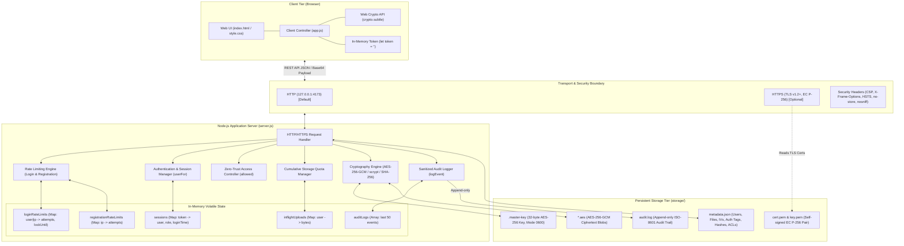
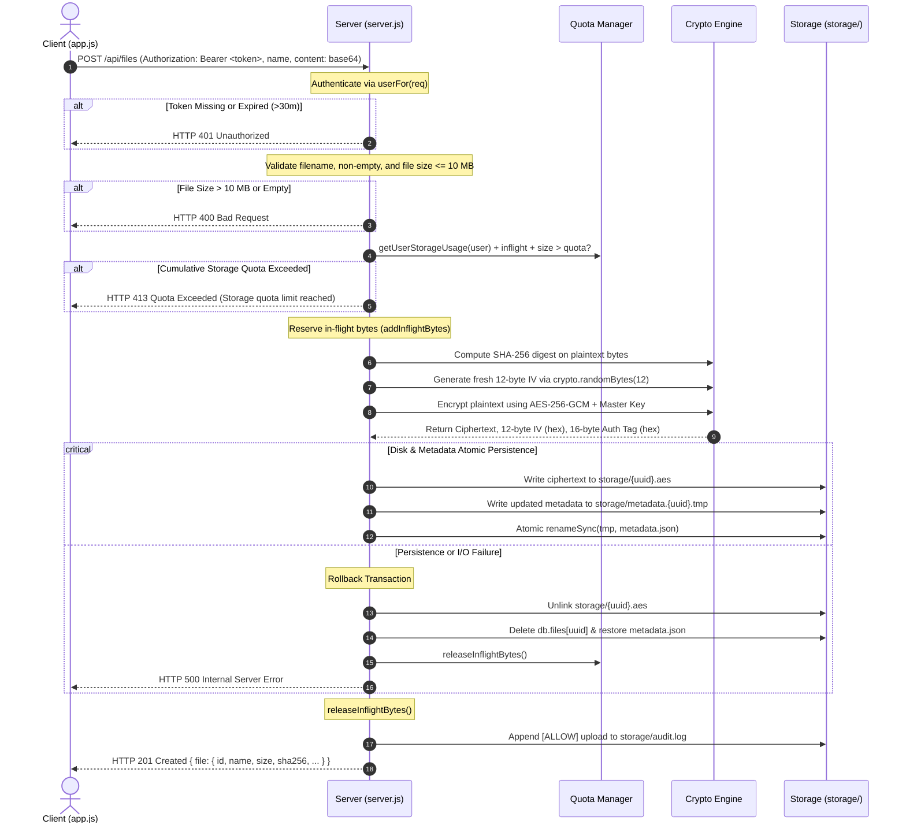
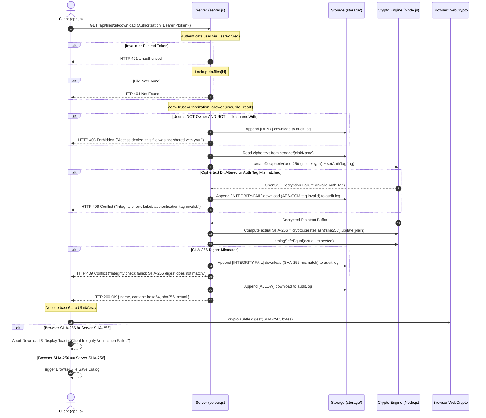
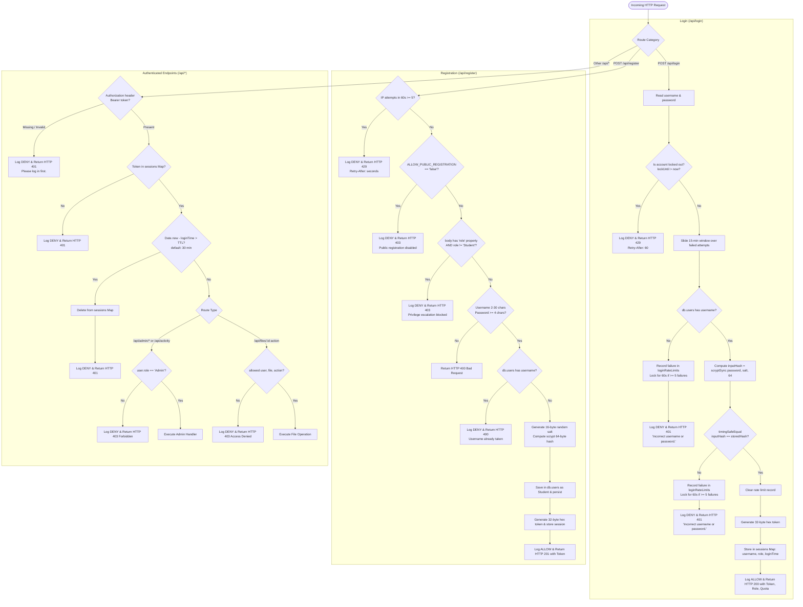

# ZTFILE — Architecture & Workflow Diagrams (Mermaid)

All diagrams below have been verified directly against the implementation in [server.js](file:///c:/Users/abhis/Desktop/CNS_LAB/course_project/Secure-Zero-Trust-File-Sharing-main/Secure-Zero-Trust-File-Sharing-main/server.js) and [app.js](file:///c:/Users/abhis/Desktop/CNS_LAB/course_project/Secure-Zero-Trust-File-Sharing-main/Secure-Zero-Trust-File-Sharing-main/app.js). No hypothetical or unintegrated components are included.

---

## 1. System Architecture Diagram



---

## 2. File Upload & Encryption Flow



---

## 3. File Download & Cryptographic Integrity Flow



---

## 4. Authentication & Authorization Flow



---

## 5. File Sharing & Revocation Flow

```mermaid
sequenceDiagram
    autonumber
    actor Owner as File Owner (Asha)
    actor Recipient as Shared Recipient (Rao)
    participant Srv as Server (server.js)
    participant Disk as Storage (metadata.json & audit.log)

    Note over Owner,Recipient: Phase 1: File Sharing
    Owner->>Srv: POST /api/files/:id/share { username: "rao" }
    Note over Srv: Authenticate Asha; verify file.owner === "asha"
    alt Requester is not File Owner
        Srv-->>Owner: HTTP 403 Forbidden ("Only the file owner can share this file.")
    end

    Note over Srv: Validate recipient exists and is not owner
    alt Recipient does not exist
        Srv-->>Owner: HTTP 400 Bad Request ("Selected user does not exist.")
    end

    Note over Srv: Append "rao" to file.sharedWith
    Srv->>Disk: Atomic persist() metadata.json
    Srv->>Disk: Append [ALLOW] share target=rao file=... to audit.log
    Srv-->>Owner: HTTP 200 OK { ok: true, files: [...] }

    Note over Owner,Recipient: Phase 2: Recipient Access Verification
    Recipient->>Srv: GET /api/files/:id/download
    Note over Srv: allowed(rao, file, 'read') -> file.sharedWith.includes("rao") === true
    Srv-->>Recipient: HTTP 200 OK { name, content: base64, sha256 }

    Note over Owner,Recipient: Phase 3: Access Revocation
    Owner->>Srv: POST /api/files/:id/revoke { username: "rao" }
    Note over Srv: Authenticate Asha; verify file.owner === "asha"
    alt Requester is not File Owner
        Srv-->>Owner: HTTP 403 Forbidden ("Only the file owner can revoke access.")
    end

    Note over Srv: Filter out "rao" from file.sharedWith
    Srv->>Disk: Atomic persist() metadata.json
    Srv->>Disk: Append [ALLOW] revoke target=rao file=... to audit.log
    Srv-->>Owner: HTTP 200 OK { ok: true, files: [...] }

    Note over Owner,Recipient: Phase 4: Revocation Verification
    Recipient->>Srv: GET /api/files/:id/download
    Note over Srv: allowed(rao, file, 'read') -> file.sharedWith.includes("rao") === false
    Srv->>Disk: Append [DENY] download user=rao (access denied) to audit.log
    Srv-->>Recipient: HTTP 403 Forbidden ("Access denied: this file was not shared with you.")
```

---

## 6. Metadata Storage & Memory Schema Structure

```mermaid
classDiagram
    class MetadataFile {
        +Object users
        +Object files
    }

    class UserRecord {
        +String salt "16-byte random hex (32 chars)"
        +String hash "64-byte scrypt hex (128 chars)"
        +String role "Student | Faculty | Admin"
    }

    class FileRecord {
        +String id "UUIDv4 string"
        +String name "Sanitized filename (max 120 chars)"
        +String diskName "{id}.aes"
        +String iv "12-byte random IV hex (24 chars)"
        +String tag "16-byte GCM auth tag hex (32 chars)"
        +String owner "Username of creator"
        +String ownerRole "Student | Faculty | Admin"
        +Array~String~ sharedWith "List of authorized recipient usernames"
        +Number size "Plaintext byte size (integer)"
        +String sha256 "Plaintext SHA-256 digest (64 chars hex)"
        +String originalSha256 "Backup digest for tamper demonstration"
        +String createdAt "ISO-8601 UTC timestamp"
        +Boolean tampered "Flag toggled by tamper demo"
    }

    class SessionRecord {
        +String token "32-byte random hex (64 chars) [Key]"
        +String username "Authenticated username"
        +String role "Student | Faculty | Admin"
        +Number loginTime "Timestamp in milliseconds"
    }

    class LoginRateLimitRecord {
        +String key "{username}|{clientIp} [Key]"
        +Array~Number~ attempts "Timestamps within 15-minute window"
        +Number failures "Number of failed attempts"
        +Number lockUntil "Lockout expiry timestamp (0 if unlocked)"
    }

    class DiskBlob {
        +Binary data "Raw AES-256-GCM ciphertext"
    }

    class MasterKeyFile {
        +Binary key "32-byte (256-bit) cryptographically random key"
    }

    MetadataFile "1" *-- "many" UserRecord : db.users
    MetadataFile "1" *-- "many" FileRecord : db.files
    FileRecord "1" --> "1" DiskBlob : references storage/{id}.aes
    DiskBlob ..> MasterKeyFile : encrypted under master key
    SessionRecord ..> UserRecord : references user & role
    FileRecord ..> UserRecord : owner & sharedWith reference users
```
